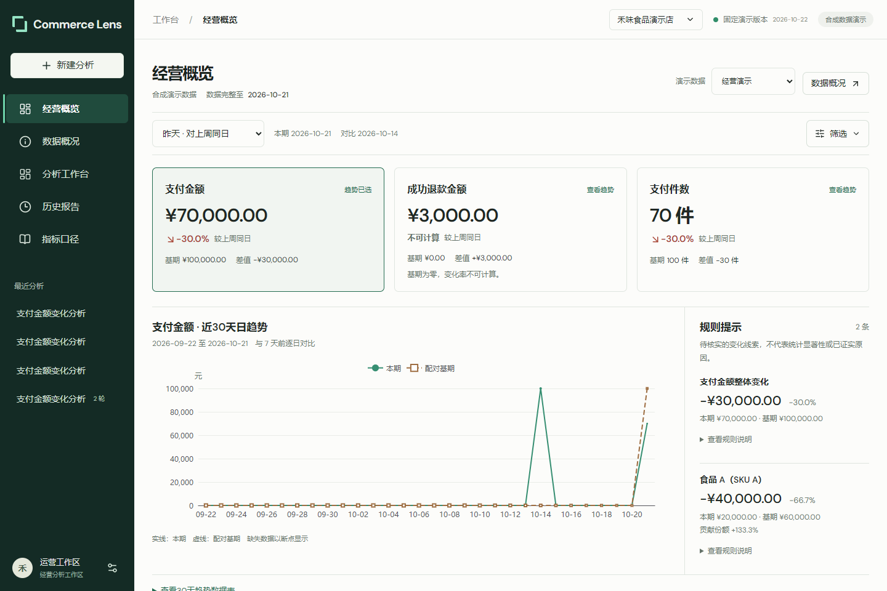

# Commerce Lens

面向电商经营分析的个人求职作品集。使用合成食品电商数据，支持支付金额、成功退款金额和支付件数分析，以及 SKU / 渠道 / 地区贡献、辅助信号、证据查看和报告导出。

技术栈：TypeScript、React、Fastify、PostgreSQL 18、开源 Pi Agent Core 与 DeepSeek。Agent 执行循环复用 Pi；本项目实现业务工具、受控查询、指标口径、权限与数据质量门禁、证据校验及评测。



## 当前能力与边界

- 前后端源码已汇总到同一个仓库，前端通过 HTTP / SSE 访问后端，不使用产品 mock 回退。
- 默认 `deterministic` 模式：真实 PostgreSQL 查询、合成业务数据，不调用外部模型。币种为 CNY，业务时区为 Asia/Shanghai，演示业务时钟为 2026-10-22。
- 提供可配置的 Pi + DeepSeek 多轮 Agent。历史单次真实模型链路的终态为 `partial`；预算优化后的真实 `completed` 验收仍未完成。
- 已有离线评测为 **120 条案例，dev / frozen-test 各 60 条**，历史 240 次执行包含 dev 一次和冻结集三次。这是确定性管线成绩，不能作为真实模型成功率，也不是“200 条冻结案例”。方法、历史结果和后续发现见 [评测说明](docs/EVALUATION.md)。
- 概览到指定数据版本的新分析闭环仍有待完成的部分，详见 [开发进度](docs/PROGRESS.md)。本项目以本地演示为目标。

## 本地启动

要求 Node.js 24、npm；Windows 使用 PowerShell 7。开发依赖会提供原生 PostgreSQL，无需 Docker 或模型 Key。

```powershell
git clone https://github.com/kue04/commerce-lens.git
cd commerce-lens
# 已安装 Node 24 可省略下一行；脚本仅在本项目下载并启用 Node。
. ./scripts/bootstrap-node.ps1
npm ci
npm ci --prefix apps/web
```

终端一，在仓库根目录启动后端：

```powershell
# 新终端需再次启用 Node 24（或使用自己安装的 Node 24）。
. ./scripts/bootstrap-node.ps1
$env:ANALYSIS_MODE = 'deterministic'
npm run api:dev
```

后端监听 `127.0.0.1:3000`，自动启动本地 PostgreSQL（端口 `55432`）、迁移并发布演示数据。首次生成数据需要等待；Ctrl+C 停止后保留本地数据和报告。若这些端口已被其他实例使用，先停止对应实例，勿同时启动。

终端二，在同一仓库根目录启动前端：

```powershell
. ./scripts/bootstrap-node.ps1
npm run dev --prefix apps/web
```

打开 [本地页面](http://127.0.0.1:5173)，可输入“昨天华东支付金额为什么下降？”。API 目录为 [本地 catalog](http://127.0.0.1:3000/api/catalog)。

要使用真实模型，将 `.env.example` 复制为 `.env`，仅在服务端配置 `DEEPSEEK_API_KEY`、`DEEPSEEK_MODEL` 并显式启用 `ANALYSIS_MODE=agent`；这会调用外部模型并产生费用。不要将凭证放入 `VITE_*` 或提交到 Git。未配置凭证时 Agent 模式会拒绝启动，不自动回退。

## 验证

```powershell
npm run typecheck
npm test
npm run build
npm run typecheck --prefix apps/web
npm test --prefix apps/web
npm run build --prefix apps/web
```

后端集成测试使用真实 PostgreSQL；普通测试不调用真实模型。浏览器回归使用 `npm run test:e2e --prefix apps/web`，首次使用可先执行 `npx --prefix apps/web playwright install chromium`。真实浏览器 / SQL oracle 测试沿用早期双目录脚本，在本仓库运行前设置 `$env:COMMERCE_LENS_BACKEND_DIR = (Get-Location).Path`。

`npm run eval:offline` 为确定性管线评测；`npm run benchmark:local` 的耗时不包含模型等待。历史验证不代表每次上传都重跑全部规模和模型评测；本次汇总验证见 [开发进度](docs/PROGRESS.md)。

## 目录与设计

- `apps/web`：React 工作台、经营概览、证据与报告。
- `apps/api`：Fastify HTTP / SSE、会话与任务生命周期、报告持久化。
- `packages/agent`：Pi runtime、受控工具、预算与报告验证。
- `packages/analytics`、`packages/metrics`：参数化查询、整数分计算、比较贡献和质量门禁。
- `packages/contracts`：共享 QuerySpec、HTTP / SSE schemas。
- `db`、`tests`、`evals`：合成明细、真实数据库测试、独立 SQL oracle 与版本化评测。

设计取舍见 [PRD](docs/PRD.md)、[计算基线](docs/decisions/0001-baseline.md)、[API 契约](docs/API-CONTRACT.md)。页面使用的 DM Sans 字体附有 [SIL OFL 许可](apps/web/public/fonts/OFL-DM-Sans.txt)。

仓库保留源码、评测与验收摘要及页面截图；`.env`、本地连接文件、数据库目录、依赖、构建产物、原始网络抓包和 ZIP 归档不上传。部分历史文档引用的原始抓包仅保留在原本地工作区。
