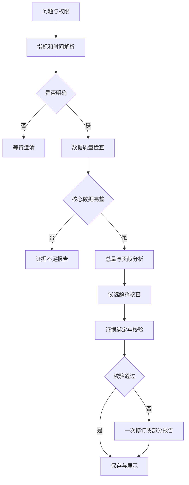
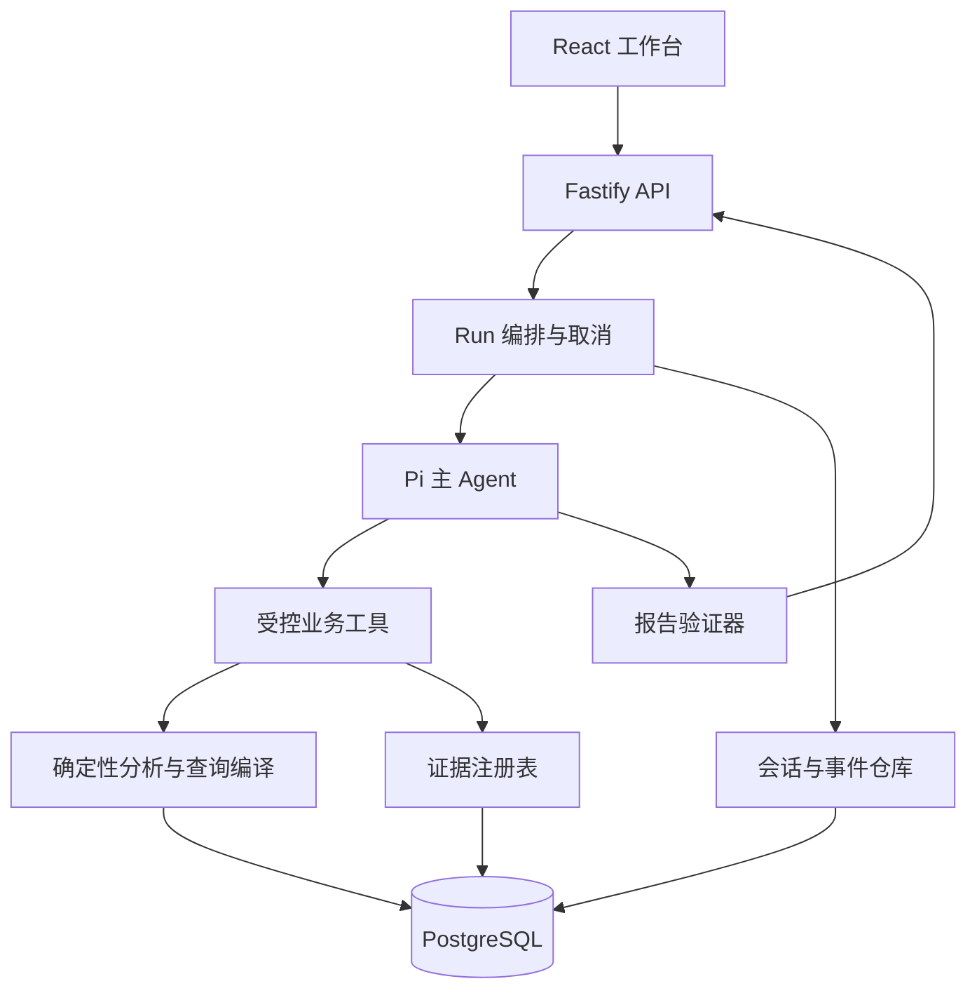

# 电商经营数据异常分析 Agent · 完整 PRD

**项目代号：Commerce Lens**  
**版本：v1.1（本地作品集实施基线）｜日期：2026-10-22｜语言：简体中文**
**用途：交给 AI 编程助手或开发者作为实施依据，并最终形成 AI 应用岗位作品集。**

本文件为实际开发的需求基线。2026-10-22 已确认：求职作品集；TypeScript + Pi；DeepSeek API；合成食品电商数据；本地运行，不要求公网。按里程碑逐步验收，进度以 docs/PROGRESS.md 和实际验证记录为准，本文不代表功能已经完成。原始 v1.0 文档保留在用户 Downloads 目录。

**协作范围：**用户同步开发 apps/web 前端；Codex 当前负责 M0/M1 数据与计算基础。前后端交接见 docs/FRONTEND-HANDOFF.md。只有已实现并验证的接口才可用于真实联调，mock 必须明确标识。

**冲突处理与修订：**公网认证/TLS/发布从当前验收范围移出，资源归属与本地访问限制保留；三个主入口为支付金额、退款金额、支付件数，订单数/客单价为辅助指标，净收款仅保留内部计算契约；数值、安全和证据约束为硬门槛，85% 完成率与 45 秒 P95 为需实测并披露差距的目标，未达目标不得声称达标。数据口径和计算精确性要求不变。

## 阅读导航

| 部分 | 内容 | 主要读者 |
|---|---|---|
| 第一部分 | 产品定位、范围、用户链路、交互与验收 | 产品/开发/面试展示 |
| 第二部分 | 技术选型、Agent 架构、运行机制与安全 | 开发 |
| 第三部分 | 数据模型、指标计算、接口和报告契约 | 后端/数据/前端 |
| 第四部分 | 项目目录骨架、测试与模拟数据设计 | 开发/测试 |
| 第五部分 | 分阶段路线、质量门禁、交付与风险 | 项目推进 |
| 第六部分 | 完整演示案例与 AI 开发交接指令 | 开发/作品集 |

**核心决策速览：**单店铺食品电商；一个主 Agent；TypeScript + Pi Agent Core + Fastify + React + PostgreSQL；先支持支付金额、退款金额、SKU 件数的变化分析；模型选择工具，SQL/代码负责计算；每条事实可追溯；先做可靠的只读分析，不自动操作业务系统。

**范围分层：**M1—M3 完成“支付金额异常”纵向最小闭环；M4 扩展退款和销量；M5—M6 完成可靠性、评测和发布，达到 P0。优先级 P0 不代表一次性实现所有模块。

---

## 第一部分：产品需求
> 本文是开发前的 PRD 与技术设计，所有功能均为待实现要求，不包含项目代码。文中的目录、接口与字段用于指导后续开发。验收指标属于目标，不代表已经取得的成绩。

### 1. 项目定位与成功标准

用户输入经营问题，系统明确指标口径与比较周期，查询可信数据，定位异常来源，检验候选解释，生成可追溯的分析报告，并支持基于已确认上下文继续追问。

项目服务于“证明能做 AI 应用开发”的目标：展示业务建模、工具调用、确定性计算、证据约束、会话管理、评测与部署。默认开发者 1 人，已有基础编程能力，可用 AI 辅助开发；不假设拥有真实企业数据或企业账号。初始领域为单店铺、多渠道的食品电商，币种 CNY，业务时区 Asia/Shanghai。一个店铺包含多个渠道、销售地区、SKU。

成功标准：面试官能在 3 分钟内看懂问题、看到数据证据与工具过程，并能在 10 分钟技术追问中得到明确的设计解释。演示必须同时包含一个成功案例、一个需要澄清案例、一个证据不足案例。第一版不以预测准确率或自动提升营业额为卖点。

### 2. 用户与任务

| 用户 | 典型问题 | 交付内容 |
|---|---|---|
| 运营负责人 | 昨天支付金额为什么降了？ | 变化幅度、贡献维度、证据、建议核实事项 |
| 商品运营 | 哪些 SKU 拖累了华东销售？ | 同一筛选口径的 SKU 贡献排序与库存检查 |
| 售后负责人 | 本周退款金额为什么升高？ | 按退款成功时间统计的变化、原因码与商品分布 |
| 开发者/评审 | 这次分析为什么这样回答？ | 结构化执行记录、查询条件、结果与验证状态 |

主要用户流程：选用演示数据集 → 输入问题 → 确认指标/时间 → 运行分析 → 查看结论和证据 → 追问 → 导出报告。高级调试面板默认折叠，不将原始模型推理作为产品内容。

### 3. 范围和优先级

#### P0：可用于简历的第一版

- FR-01：自然语言输入、预置示例、问题长度限制 2,000 字符。
- FR-02：识别支付金额下降、退款金额上升、SKU 销量异常；不支持的问题说明边界。
- FR-03：时间与指标澄清；按问题提供“支付金额/退款金额/支付件数”“昨天/近 7 天”“上周同期/前一周期”选项。净收款不作为第一版独立入口。
- FR-04：数据完整性检查、同比较窗口校验；完整自然日分析优先。
- FR-05：总量比较、单维度贡献分解、对选定切片继续下钻。
- FR-06：库存、流量、退款原因码、活动记录的受控查询；按数据可用性返回证据不足。
- FR-07：结构化报告，数值绑定证据，事实、可能解释、缺失证据分栏。
- FR-08：最多 10 轮会话的结构化上下文，支持“只看华东”“剔除这个 SKU”等追问。
- FR-09：流式任务状态、取消、错误提示、报告重载；页面刷新后能恢复已保存报告。
- FR-10：执行记录，包括工具、参数摘要、耗时、结果行数、版本、成本与终止原因。
- FR-11：模拟数据、确定性种子、已知异常场景、离线评测与失败案例。
- FR-12：当前交付为本地单人模式，仅监听 loopback；会话、报告和证据保留 owner/store 归属检查。公网部署与真实登录不纳入本次验收；未来开放公网前必须实现部署认证与权限回归。
- FR-13：Markdown/JSON 导出，包含模拟标识、口径、时间窗口、证据与限制。

#### P1：P0 验收后再做

- 半自动 CSV 导入：映射预定义字段、校验、预览、用户确认；不支持任意表结构猜测后直接入库。
- 可由用户管理的阈值、稳健统计异常检测、指定时间日报；新增后重做相关评测。P0 已有服务端配置的固定业务规则提示，不属于统计显著性检测。
- 多模型对比、自定义业务口径管理、OpenTelemetry 对接。
- 独立 Python 分析服务，仅在确有统计分析库需求时增加。

#### 明确不做

任意数据库自主探索、任意 SQL/代码执行、自动改价或采购、自动发送消息、无人审批的业务写入、多 Agent“专家团队”、复杂 RAG 平台、多租户 SaaS、微服务与 Kubernetes。报告中的建议只是供人判断，不触发业务动作。

### 4. 关键产品决策

| 决策 | 选择 | 理由 |
|---|---|---|
| Agent 数量 | 一个主 Agent | 三类问题共享查询与证据链，无需拆角色传话 |
| 分析策略 | 有约束的动态工具选择 | 不同异常需要不同查询，但关键计算可验证 |
| 查询方式 | 模型生成 QuerySpec，由代码编译参数化 SQL | 指标和维度可控，避免自由 SQL 的安全与口径漂移 |
| 数据基础 | PostgreSQL，开发初期可用固定聚合 fixture 验证链路 | 先把计算和接口做实，再接持久化和明细层 |
| 展示形式 | Web 分析工作台 | 业务用户看结论，技术评审可展开过程与证据 |
| 知识管理 | 版本化指标目录和规则 | 小规模固定口径不需要引入向量库 |
| 记忆 | 结构化会话状态与报告引用 | 不让模型摘要代替权威指标与数据库 |

### 5. 业务指标的定义

所有金额以人民币“分”存储和计算，API 用安全范围内整数；超过 JavaScript 安全整数范围拒绝或改用十进制字符串。界面最后一步换算为元，展示两位小数。数量为整数。比率以 number 计算，金额加减以整数计算；金额均非安全整数时禁止进入计算。计算未舍入的中间值，展示层单独格式化。日期范围是 [start, endExclusive)，按 Asia/Shanghai 生成 UTC 查询边界。

| metricId | 定义/时间口径 | 注意 |
|---|---|---|
| paid_amount | 成功支付订单的实付商品金额之和，按 paid_at | 不含运费，优惠已分摊到订单行；后续退款不回写历史支付值 |
| paid_orders | 成功支付订单去重数，按 paid_at | SKU 切片下订单可能重叠，因此不得用 SKU 订单数做可加贡献 |
| sold_units | 成功支付订单行数量之和，按 paid_at | 为支付件数，不扣后续退款件数 |
| refund_amount | 成功退款事件的金额之和，按 succeeded_at | 失败/处理中退款不计入；同订单可有多次部分退款 |
| net_receipts | 本期 paid_amount − 本期 refund_amount | 属于现金流时间口径，退款可能来自历史订单，可为负 |
| aov | paid_amount / paid_orders | 分母为 0 返回 null，不返回 0 |
| refund_rate_7d | 付款 cohort 在付款后 7 日内成功退款订单数 / cohort 支付订单数 | P1；需成熟 7 天并显示截至时间，P0 不展示含混的“退款率” |
| payment_conversion | 同一渠道/地域/日期的支付订单数 / sessions | 流量是会话数而非 UV；仅在归因口径匹配时展示；P0 为辅助证据 |

支付渠道取订单支付时渠道，地区取订单收货地区的标准化大区，不保存具体地址。退款继承原订单行的渠道与地区。商品类目使用销售时快照，避免历史口径随商品主数据变化。

默认：用户明确“昨天销售额”时，页面显示“按支付金额、昨天完整自然日、上周同一星期分析”，允许修改；“数据异常”不含指标必须澄清；“今天”在 P0 提示数据未完整，建议昨天，不与完整昨天直接对比。用户明确询问今天时，返回不支持完整日结论及最新水位，不悄悄替换时间。

时间补充：周一为一周起点。“本周”指本周一至昨天，与上周相同星期范围比较；周一尚无完整日时要求改选范围。“近 7 天”指截至昨天的连续 7 个自然日，默认比较前 7 天。每次展示实际起止日期。日期支持范围为 2000—2100 年。

能力分层：paid_amount、refund_amount、sold_units 是主分析入口；paid_orders、aov 是辅助比较，不做可加贡献；net_receipts 仅在内部计算层支持，暂不开放自然语言独立入口。M1 可先验证六个指标的底层运算，这不表示 M4 的退款/销量 Agent 与信号工具已经交付。

### 6. 完整分析链路

1. 后端获取真实身份、storeId、会话归属、数据集版本、业务日期，禁止从模型参数覆盖权限。
2. 校验问题长度与会话并发。创建 runId，持久化 received 事件。
3. 解析 AnalysisIntent：指标、当前窗口、比较窗口、筛选、问题类型；结合会话已确认状态。
4. 指标不明确/窗口不完整/筛选冲突时进入 needs_clarification。此状态无数据查询开销；回答后新建 run 并关联 parentRunId。
5. 服务端强制检查相关数据源水位、关键字段、重复主键、退款关联完整性，模型不能跳过。支付/件数/订单数/客单价需要 orders 和 order_items；退款及净收款还需要 refund_events。任一必需源缺失 → insufficient_data；库存缺失只禁用库存解释，不阻止总量分析。检查覆盖起点、排他性完整截至日期和窗口内缺失分区；源最新时间不代表完整覆盖。
6. compare_metric 获取确定性总量；变化率=(current−baseline)/baseline，baseline=0 时为 null 并标“基期为零”。
7. Agent 选择合适维度做贡献分析；只允许当前指标的可加维度。先单维度，再对已选切片下钻；不把渠道贡献和 SKU 贡献相加。
8. 根据贡献项形成最多 3 个候选解释并决定核查工具。证据来源可能是库存、流量、活动或退款原因码。
9. 工具结果注册 evidenceId，保留 querySpec、snapshotId、metricVersion、实际值、结果 hash、生成时间。
10. 模型提交 ReportDraft；确定性验证器核对引用、数值、范围、单位与结论级别，禁止不存在的 evidenceId。
11. 如验证失败，仅允许一次针对错误的修订；仍失败则输出数据工具生成的受限报告，状态 partial，不标记完整成功。
12. 保存报告与最终状态，前端展示结论、图表、证据及未知项。追问继承已确认筛选，重新查询受影响数据，不复用过期数值。

阶段图：

### 7. 数学约束与解释规范

#### 可加指标贡献

对一个维度的互斥、穷尽分组：delta_i = current_i − baseline_i；总变化 delta = Σdelta_i；带符号贡献 share_i = delta_i / delta。总变化为零时 share=null。share 可以为负或大于 100%，不得截断。例如总额下降 300，A 下降 400、B 增长 100，贡献分别为 133.33% 与 −33.33%。图表明确增长项抵消下降项。

Top-N 必须附“其他”残差；展示前验证分组合计等于总量。渠道与地区属于不同切面，不能把它们各自解释的百分比求和。基期没有的新 SKU 当前出现时基期为 0，不能丢失。AOV 等比率不直接计算金额贡献；第一版只比较并拆分分子/分母。

Top-N 排序固定为绝对变化金额/数量降序，键按字典序打平；仅存在省略分组时加入“其他”，残差在取 Top-N 前用全量分组计算。基期为零的变化率为 null；净收款若基期为负，底层仍保留原公式值，但不输出“经营改善百分比”语义，后续若开放入口需单独展示负基期限制。

#### 异常和原因

第一版回答“变化发生在哪里”，用户认为异常不等于统计检验已证明异常。初始异常提示是显式业务规则：支付金额基期≥10,000 分，且跌幅≥15%；退款金额增幅≥30% 且增加≥5,000 分；件数基期≥20 且跌幅≥20%。这些阈值可配置，均标注“规则提示”。不使用不足历史样本的 z-score 包装统计显著性。

报告三种陈述：

- observed：直接观测事实，例如 SKU-A 支付金额下降 4,000 元，有查询结果支撑。
- supported_hypothesis：相关证据支持的可能解释，例如缺货时段与销量下降重叠，但无法估计因果损失。
- unknown：缺少曝光/库存/活动等信息，列出下一步需核实的数据。

禁止输出没有来源的置信度 93%、虚构营业额损失、用相关性声称因果。活动记录只能说明时间重叠；退款原因码只能说明客户选择的分类，不能证明产品质量事故。

### 8. 页面与交互

#### 分析工作台

桌面采用左侧历史/示例、中间对话和报告、右侧证据抽屉；窄屏切为“分析/证据”标签。不要求炫技动画。顶部常驻模拟数据标识、当前店铺、时区、数据更新时间；无 API Key 的 fixture 演示模式单独标明。

输入区包含示例：“昨天支付金额为什么下降？”“只看华东，再按商品拆解”“本周退款金额上涨集中在哪些商品？”发送后显示运行阶段和取消按钮，不可重复创建同一任务。Enter 发送、Shift+Enter 换行；加载/成功/失败信息可被屏幕阅读器读出。

报告卡片顺序：分析口径 → 总量与变化 → 贡献条形图 → 事实与候选解释 → 建议核实 → 数据限制。图表提供表格替代，不仅用红绿区分状态。点击证据编号展开工具名、筛选、时间窗口、结果表、数据版本；技术角色可展开脱敏 SQL 模板与参数。

执行时间线只显示“比较支付金额”“按 SKU 拆分”“检查库存”等动作摘要，不显示模型隐藏推理。原始工具 payload 按角色访问，不向普通用户展示身份令牌或数据库连接信息。

#### 空、慢、错与取消

| 状态 | 页面行为 |
|---|---|
| 无历史数据 | 展示载入演示数据入口和支持范围 |
| 需要澄清 | 展示最多 3 个明确选项，保留原问题 |
| 核心数据缺失 | 说明缺少日期/数据源，不输出下降结论 |
| 某个证据工具失败 | 保留已有事实，报告 partial，并标记缺失的解释 |
| 超过 30 秒 | 显示已完成阶段与取消入口，不能假装完成 |
| 超过 90 秒 | 中断模型/工具，保存部分结果或 timed_out |
| 用户取消 | 后端发取消信号；不继续写成功状态或发新工具请求 |
| SSE 断线 | 用最后事件序号恢复；历史可回放，但不重复执行查询 |
| 服务重启 | 将遗留 running 标记 interrupted，允许以新 run 重试 |

### 9. 运行限制、隐私与可靠性

每次 run（包含意图解析、报告修订和失败重试）最多 8 次模型请求、12 次工具调用、90 秒墙钟时间、累计输入输出 30,000 tokens；总成本预算默认等值 0.30 美元。价格来自有版本的配置，无法计价时显示 unknown，仍执行 token/调用数/时间硬限制。模型请求开始前先检查剩余额度；单次 token 上限受剩余额度约束，成本可能有单次请求内的估计偏差，报告保留实际用量。

单查询默认 3 秒超时，最多 200 个聚合分组（不包括其他残差行）、最多 31 天窗口、最多 3 个筛选字段；最多 2 个同时运行任务，全局等待队列上限 10。业务只读角色、固定表白名单、固定枚举字段、参数化值。禁止文件、shell、浏览器、任意 HTTP 工具。

模型仅收到聚合数据和必要商品标识，不传手机号、地址、姓名、邮件。用户输入与商品文案均为不可信数据，不能变更工具权限。日志不记录 API Key；报告和执行记录都检查 ownerId/storeId。生产禁止把单人演示模式暴露到公网。

### 10. 验收目标

| 类别 | 目标 | 如何测 |
|---|---|---|
| 确定性计算 | 金额、件数与独立 SQL oracle 一致率 100% | 整数精确比较；比率误差≤1e-8 |
| 主任务完成 | 可回答测试集完成率≥85% | 意图、查询、数值、证据、合法终态全部通过 |
| 证据覆盖 | 事实型陈述有有效引用比例 100% | 结构化事实逐条核对 |
| 不支持输入 | 不执行越权或写操作 | 攻击样本工具日志检查，测试集要求 100% 阻止 |
| 澄清 | 歧义样本澄清召回≥90% | 标注集对比，另报误澄清率 |
| 速度 | 指定 10 万订单/单用户环境 P95≤45秒 | 固定模型版本、网络环境、20 次预热后 100 次运行 |
| 成本 | 报告每任务中位数、P95、失败成本 | 不预先编造效果，0.30 美元为运行预算 |
| 可复现 | 同一 seed、snapshot、metricVersion 得到相同数值 | 两次 seed + 独立 oracle |

准确率是模拟环境评测结果，不等于企业真实业务准确率；“效率提升”只有完成对照人工实验后才能写简历。

### 11. 交付与完成定义

本地作品集 P0 完成必须同时拥有：可本地启动应用、真实 Pi + DeepSeek 模型闭环、PostgreSQL 数据接入、持久化会话和报告、查询权限隔离、标准失败路径、冻结测试集、评测记录、启动说明、演示脚本与架构说明。公网发布不属于本次验收。仅有聊天界面、固定答案、CLI 模型调用或项目骨架，不等于 P0 完成。正确性、权限、安全和证据门槛必须通过；完成率/延迟等效果目标需如实记录，不达标时说明差距。

本文同时规定项目目录骨架、模块职责与阶段路线。后续开发按第五部分推进，先确认数据口径，再搭建分析闭环与界面。

## 第二部分：技术架构与运行机制

### 1. 选型结论

| 层 | 选择 | 取舍 |
|---|---|---|
| 语言/运行时 | TypeScript strict、Node.js 24 LTS | 与 Pi 原生生态一致；单语言减少个人项目维护成本 |
| Agent | @earendil-works/pi-agent-core + pi-ai 1.4.0 | 使用 Agent 核心，不嵌入带文件/shell 权限的 coding-agent CLI |
| API | Fastify | 明确路由、schema、日志与测试注入；无需引入大型业务框架 |
| 前端 | React + Vite + CSS；P0 图表采用 ECharts | 初期不依赖 SSR/SEO；证据表与状态展示优先 |
| 数据 | PostgreSQL 18、pg 驱动、版本化 SQL migrations | 能直接审查 SQL；先定义粒度和约束，再编写迁移 |
| 参数/契约 | TypeScript + TypeBox/JSON Schema | Pi 工具兼容；HTTP、报告边界也要做运行时校验 |
| 流式 | SSE + REST | 服务器单向推送足够；不引入 WebSocket |
| 测试 | Node test runner + tsx；M3 加 Playwright | 计算和接口先测，真实模型测试单独预算 |
| 打包 | 单仓库分目录、一个 package-lock.json | 无需 monorepo 编排器；模块用相对 import，后续才拆 workspace 发布 |
| 运行 | Windows 本地 Node + PostgreSQL，浏览器访问 | 不要求公网；反向代理/TLS 仅在未来公网部署时实施 |

Pi 版本与命名按 2026-10-22 的官方文档及 npm 元数据核对，旧教程的 @mariozechner 命名与 getModel 用法不直接照搬。建议适配层使用 createModels、provider factory、Agent 与 streamFn。开发时由 package-lock 固定实际安装版本；升级 Pi 必须独立运行类型、工具调用和取消测试，不把版本升级混入业务变更。

替代方案：Python/FastAPI + Pi Node sidecar 适合已有 Python 算法服务，但增加双进程与契约维护；纯 Python Agent 框架更符合 Python 团队，却偏离本项目练习 Pi 的目标。当前选择全 TypeScript；SQL 足以完成第一版聚合与分解。

### 2. 依赖关系

contracts 不依赖框架；analytics 不依赖 Pi/HTTP；agent 依赖 contracts/analytics 和 Pi；API 组装鉴权、存储、Agent；web 只依赖公共契约。业务计算中不允许调用模型。模型调用只发生在 agent 模块。

### 3. 各模块职责与未来文件

| 路径 | 职责 | 禁止承担 |
|---|---|---|
| packages/contracts/src/index.ts | QuerySpec、证据、报告、事件类型 | 数据库访问 |
| packages/analytics/src/compare.ts | 固定整数聚合、差值和贡献 | 生成业务原因 |
| packages/analytics/src/fixture.ts | 开发阶段最小聚合 fixture | 宣称完整模拟业务数据库 |
| packages/analytics/src/query-compiler.ts（规划） | 枚举到 SQL 模板，绑定参数 | 拼接模型给出的表名/列名 |
| packages/agent/src/pi.ts | Pi 适配与工具注册、预算 | 直接拼接 SQL |
| packages/agent/src/report-validator.ts（规划） | 引用/数值/口径/状态验证 | 使用第二个模型替代确定性校验 |
| apps/api/src/app.ts | 路由和输入验证 | 长业务推理 |
| apps/api/src/runs/*（规划） | 执行状态、事件、重试、取消 | 共享不同用户的 Agent 实例 |
| apps/web/src/* | 交互、证据展示、可访问性 | 保存 API Key、可信计算 |
| db/001-schema.sql | 目标表结构起点 | 自动迁移生产数据库 |
| evals/* | 标注案例与测试定义 | 作为模型可见的正确答案 |

### 4. 数据进入到报告出库

源 CSV/种子 → staging 类型校验 → 主键去重/退款关联校验 → 分配 datasetVersion → 事务发布 business tables → 水位更新 → analysis snapshot 固定 → QuerySpec 编译 → 只读查询 → deterministic result → evidence → ReportDraft → validate → reports 持久化 → SSE report.ready。

P0 的 snapshot 使用不可变已发布 datasetVersion，各次查询绑定同一版本。不要把 snapshotId 仅用作标签，却实际读正在修改的数据。真实增量接入时，可改为版本化汇总表或一致性快照；长时间 Agent 会话不持有长期 PostgreSQL 事务。

### 5. Agent runtime 与工具契约

第一版工具控制在 6 个，名称固定：

| 工具 | 输入 | 输出 | 执行规则 |
|---|---|---|---|
| get_metric_definition | metricId | 定义、版本、单位、可用维度 | 返回只读目录 |
| check_data_quality | 规范化窗口、数据源 | 水位、缺失、严重级别 | 核心缺失阻断结论 |
| compare_metric | QuerySpec | 当前/基期/差值/变化率、evidenceId | 固定聚合模板 |
| decompose_change | QuerySpec + dimension | 互斥分组、其他、总量校验 | 仅可加指标 |
| inspect_signals | signalType + 切片 + 窗口 | 库存/流量/活动/退款原因证据 | 不做因果判定 |
| submit_report | ReportDraft | validation errors 或 reportId | 通过验证后运行结束 |

工具结果统一形状：{ok, data, evidenceId?, error?:{code,retryable,message}, truncated, durationMs, snapshotId, metricVersion}。没有数据用明确标识，不能用空数组含混表示“查询失败”。禁止把异常堆栈或数据库凭证传给模型。

候选解释最多 3 个；每个需要“支持证据/反证/缺失信息”。模型可以选择查哪些已授权信号，不能在工具中指定 storeId/ownerId。上下文注入的权限由服务端持有，模型只能引用。

### 6. 状态机、幂等与取消

主状态：queued → running → completed | partial | needs_clarification | insufficient_data | failed | cancelled | timed_out | interrupted。终态不可再次改为 running。恢复需求新建 run 并指定 parentRunId，保留原失败记录。

详细 phase：received / interpreting / checking_data / comparing / decomposing / inspecting / validating / persisting。phase 是展示与执行记录，不是自由文本模型控制流。

POST /runs 要求 Idempotency-Key；同用户+同 key+同 body 返回原 run，不同 body 返回 409。一个会话只允许一个活动 run；并发冲突 409。run.stateVersion 乐观锁防止取消与完成互相覆盖。取消后先设置 cancel_requested，再 AbortController 中断模型与查询，CAS 写 cancelled；已经完成则返回当前终态。

SSE 用 (runId, seq) 唯一递增，写数据库后再发送。断线只断开订阅，不默认为取消；用户点击取消通过 POST。Last-Event-ID 从数据库重放，客户端按 seq 去重。心跳 15 秒；无新数据也保持连接；代理禁用缓冲。超过保留期返回 replay_expired 并提供最终报告接口。

模型调用失败仅对 429/暂时性 5xx 退避重试一次，受同一 90 秒与总预算约束。数据库只读工具可重试一次；认证、参数、口径错误不可自动重试。重复工具调用用 runId + 标准化 QuerySpec hash + snapshotId 缓存，仍计调用尝试上限，防止循环绕过预算。

### 7. 上下文与记忆

SessionState={metricId, metricVersion, currentWindow, baselineWindow, filters, selectedDimension, lastReportId, confirmedFactsRefs, pendingClarification, datasetVersion}。只有用户确认或校验后的状态可写入。会话历史最多保留最近 10 轮供模型使用，历史报告只带摘要与 evidenceId，不灌整张订单表。

上下文预算分配建议：系统与工具 schema 20%、本轮意图与已确认状态 20%、证据摘要 45%、最近对话 15%。接近模型上下文限制时优先移除旧原始工具内容，保留不可替代口径与本轮证据；超过 30,000 累积 token 运行预算停止。摘要只是便于阅读，不替代原始证据。

默认不做跨用户长期偏好记忆。跨会话可以显式选择已保存报告作为背景，先重新鉴权和校验数据版本。schemaVersion/metricVersion 变化时使缓存失效，提示重新确认受影响指标。

### 8. 安全边界

API 身份通过 session cookie（HttpOnly、SameSite）或验证 JWT 获取；部署时加入 CSRF 防护与固定 origin。不要把浏览器提交的 storeId 当作访问授权。MVP 一个店铺，但每个 run/report/evidence 记录 ownerId，所有读取带归属条件。未来多店铺需额外做 RLS，业务查询角色不能是表 owner/superuser/BYPASSRLS；仅打开 RLS 并不自动安全。

数据库连接分迁移管理员、业务查询只读、应用状态写入三类。初期可以同实例不同 schema（business、app），但不能让模型通过任意工具读 app 中其他用户会话。查询限制由服务器执行，不靠 prompt。列枚举映射，值用绑定参数；固定 SELECT 模板，禁止用户原始 SQL。

输入提示注入作为普通数据处理，攻击测试必须检查实际工具调用而非只看回答。无外网工具，无文件写入工具。模型供应商会收到聚合业务数据，生产接入前应由数据所有者决定允许范围；演示只使用合成数据。

### 9. 可观测性与模型选择

日志字段：traceId/runId/ownerIdHash/phase/toolName/durationMs/rowCount/tokenUsage/costEstimate/modelId/promptVersion/metricVersion/schemaVersion/datasetVersion/terminalReason。用户问题默认日志截断或哈希，调试模式需显式打开。

模型默认使用 DeepSeek provider，通过环境变量配置账号当前可用且支持工具调用的具体 modelId；以固定 Pi 版本实际目录和最小连通性检查为准。没有凭证时继续确定性开发，明确标记真实模型未验证。用开发集选择配置，冻结集仅用于最终评估；任务完成率、工具参数正确率、P95 与成本均需记录。供应商切换需 adapter smoke 与回归，不在运行中悄悄换模型。

### 10. 部署路线

本地 Windows：Node 24 LTS + npm。第一阶段 fixture 模式不需要数据库/API Key；完整 P0 需要 PostgreSQL 18 和可用模型凭证，可选 Docker Desktop 运行数据库。依赖安装后只用 npm ci 重现；密钥保存在 .env，不提交 Git。

演示部署：构建 React 静态资源 → 反向代理同域托管 /api → Node API → PostgreSQL 内网。TLS 在反向代理结束；数据库端口不对公网；上线前启用真实身份校验、速率限制、密钥管理与预算。健康检查分 /health/live 和 /health/ready；前者不访问外部，后者检查数据库与配置，不每次调用模型。

备份 app 会话/报告与 datasetVersion 对应数据；migrations 在上线前单独运行。升级失败回滚应用镜像，数据库采用向前兼容的新增字段迁移，避免上线时破坏既有报告。单人演示成本以实际 LLM 调用和主机账单记录，不写未经测量的月费用。

### 11. 官方依据（核对日期 2026-10-22）

- Pi Agent Core： [https://github.com/earendil-works/pi/blob/main/packages/agent/README.md](https://github.com/earendil-works/pi/blob/main/packages/agent/README.md)
- Pi 模型层： [https://github.com/earendil-works/pi/blob/main/packages/ai/README.md](https://github.com/earendil-works/pi/blob/main/packages/ai/README.md)
- Node 发布策略： [https://nodejs.org/en/about/previous-releases](https://nodejs.org/en/about/previous-releases)
- Fastify 支持策略： [https://fastify.dev/docs/latest/Reference/LTS/](https://fastify.dev/docs/latest/Reference/LTS/)
- PostgreSQL 行级权限与绕过条件： [https://www.postgresql.org/docs/current/ddl-rowsecurity.html](https://www.postgresql.org/docs/current/ddl-rowsecurity.html)
- Vite： [https://vite.dev/guide/](https://vite.dev/guide/)

上述来源用于验证框架机制；本项目架构、预算、阈值和验收值均为设计决策，不是官方默认。

## 第三部分：数据模型、接口与报告契约

### 1. 数据集、主键和时间约定

所有业务事实都属于不可变 datasetVersion；一个发布版本对应完整的一致数据集。初期生成 90 个自然日、10 万订单、约 20 万订单行、30 个 SKU、3 个渠道、4 个大区的数据，用于功能与性能评测。规模是开发目标，不代表已经生成。渠道、地区均使用固定字典；未知项单独归到 unknown，禁止静默丢弃。

业务实体键按 (dataset_version, store_id, entity_id) 唯一。跨事实关联必须包含版本和店铺，不能只用外部平台 order_id。存储时间为 timestamptz，用户输入日期按 Asia/Shanghai 解析；所有日志包含 UTC 时间和业务日期。种子数据使用固定业务时钟，例如以 2026-10-22 为演示“今天”；界面显著标示演示时钟，避免过几个月再演示时所有“昨天”查询为空。

### 2. 业务表设计

| 表 | 一行代表什么 | 关键字段 | 约束与用途 |
|---|---|---|---|
| datasets | 一次不可变数据发布 | dataset_version、schema_version、seed、published_at、business_clock、is_synthetic | 状态 draft/published；仅 published 可分析 |
| products | 一个版本下的一款 SKU | store_id、sku_id、name、category | 商品文案视为数据，不作为系统指令 |
| orders | 一笔订单 | order_id、store_id、paid_at、payment_status、channel_id、region_id、paid_amount_cents | 仅 succeeded 计支付；金额等于行实付之和 |
| order_items | 一笔订单中的一行商品 | order_item_id、order_id、sku_id、category_at_sale、quantity、paid_amount_cents | quantity>0；优惠分摊完成；关联 orders |
| refund_events | 一次订单行退款事件 | refund_event_id、order_item_id、succeeded_at、status、refund_amount_cents、refunded_units、reason_code | 允许多次部分退款；只统计 succeeded；累计成功退款不超过该行可退金额 |
| inventory_hourly | 某 SKU 在某大区可售库存的一小时时点 | sku_id、region_id、hour_at、available_units、is_observed | 每小时一条；缺记录不视为零库存 |
| traffic_daily | 渠道×大区×日期的会话汇总 | channel_id、region_id、business_date、sessions、attribution_version | 不含 SKU 粒度；禁止推断 SKU 转化率 |
| promotion_events | 某项活动的一个生效范围 | campaign_id、start_at、end_at、channel_id、sku_id、event_type | 可与销售重叠，仅做佐证；无可信标签则不推断效果 |
| source_watermarks | 数据源的一次覆盖检查 | source、dataset_version、complete_through、missing_partitions、checked_at | 数据源级别水位；不能只看全库最新时间 |

所有表包含 dataset_version；可按数据集级别记录 store_id 的表不得在工具侧接受任意 storeId。原始手机号、收货地址、用户姓名不进入本项目。

库存只记录“大区库存池”，与大区销售关联，不推断某渠道独享库存；如果业务实际上各渠道库存隔离，接入前必须新增 channel_id 并调整指标版本。活动作用范围为可选 SKU 和渠道，空值表示全范围，必须明确处理，不能靠 JOIN 无意复制销售行。

**禁止的 JOIN：**订单行直接关联多条退款事件后再 SUM 支付金额，会重复支付金额。支付和退款分别聚合到所需维度后合并；refund_amount 按退款时间过滤，paid_amount 按付款时间过滤。paid_orders 使用去重订单数，不能简单 SUM 各 SKU 的订单计数。

**净收款的维度合并：**对 current 和 baseline 的支付、退款结果取完整维度键并集，缺侧金额补零；不使用仅保留两侧都存在键的 inner join。核心数据源缺失时不允许补零假装真实零值。

**索引起点：**orders(dataset_version, store_id, paid_at)、order_items(dataset_version, store_id, order_id)、refund_events(dataset_version, store_id, succeeded_at)、inventory_hourly(dataset_version, store_id, sku_id, region_id, hour_at)。先用 EXPLAIN ANALYZE 在目标规模验证，再决定分区与汇总表，不提前建立大量索引。

### 3. 应用状态表

| 表 | 主键/重要字段 | 用途 |
|---|---|---|
| sessions | session_id、owner_id、store_id、state_json、state_version | 已确认口径与上下文 |
| runs | run_id、session_id、owner_id、status、phase、parent_run_id、idempotency_key、request_hash、model_id、prompt_version、snapshot_id、started_at、ended_at | 任务生命周期与预算统计 |
| run_events | run_id+seq、event_type、payload、created_at | 有序事件、SSE 重放 |
| evidences | evidence_id、run_id、query_spec、metric_version、result_json、result_hash、row_count、source_watermark | 查询证据，结果不可覆写 |
| reports | report_id、run_id、owner_id、report_version、report_json、validation_json、created_at | 事实、假设与未知项；重生成建新版本 |
| feedback | feedback_id、report_id、owner_id、rating、issue_type、comment | 错误案例回收；不自动变成可信知识 |

P0 本地单人模式使用固定 owner，仅监听 loopback；部署模式通过认证产生 owner。开发数据库与生产数据库不能共用凭证。默认会话/证据/日志保留 30 天，允许删除本人会话及关联数据；导出文件由用户自行管理。演示数据可重建，不做不可解释的长期留存。

### 4. QuerySpec 与 Evidence 的字段规范

QuerySpec 是模型和查询引擎之间的有限语言，不含原始 SQL。

| 字段 | 类型/取值 | 校验 |
|---|---|---|
| metricId | paid_amount / paid_orders / sold_units / refund_amount / net_receipts / aov | 必须存在指标目录 |
| currentWindow | startDate、endDateExclusive | 合法 ISO 日期；完整日；1—31 天 |
| baselineWindow | startDate、endDateExclusive | 与当前窗口天数相同；P0 不允许重叠 |
| filters | channelId[]、regionId[]、skuId[] | 只支持三个键；每个数组最多 20 个去重字典值 |
| groupBy | none / channel / region / sku / category | 一次一个维度；字段不能自由输入 |
| topN | 整数 1—20 | 默认 10；其他项必须补齐 |

storeId、ownerId、snapshotId、metricVersion、权限均由后端上下文绑定，模型不可提供或修改。多个维度过滤为 AND，同一数组内为 OR；空数组拒绝，用户清除筛选应删除键。schema 采用 additionalProperties=false。

Evidence 至少记录：evidenceId、runId、metricId、unit、current/baseline 窗口、filters、datasetVersion、metricVersion、queryTemplateId、参数摘要、结果、resultHash、createdAt、数据源覆盖状态。字段值用于确定性验证，不把解释性自然语言当作数值来源。

### 5. 分解工具和信号工具的特殊规则

- decompose_change 仅允许 paid_amount、sold_units、refund_amount、net_receipts；paid_orders 与 aov 不允许做 SKU 可加贡献。
- 分解先返回全量聚合计算总量，再裁切 topN；200 个分组上限超限时要求缩小范围或换维度，不能静默截断参与总量计算的数据。
- inspect_signals 的 signalType 限定 inventory / traffic / promotion / refund_reason。切片必须属于当前已授权 QuerySpec；允许缩小筛选，不允许跨店铺扩张。
- inventory 输出覆盖小时数、观测小时数、零库存小时数、覆盖率。覆盖率不足 95% 则不能说“全天未缺货”；只有有记录的零值算零库存。
- traffic 只能在 channel/region/date 粒度核查；SKU 问题可以展示渠道流量背景，并明确“无法直接归因到该 SKU”。
- refund_reason 输出成功退款金额和事件数的分类分布；原因码缺失占比单列；不把事件数当退款订单数。
- promotion 输出匹配活动及时间，报告只能写“与活动结束时间重叠，需核实影响”。

### 6. HTTP 接口清单

| 接口 | 请求要点 | 响应/行为 |
|---|---|---|
| GET /api/health/live | 无 | 存活状态，不请求模型 |
| GET /api/health/ready | 服务端检查配置/数据库 | 200 ready / 503 not_ready |
| GET /api/catalog | 当前身份 | 指标、维度、可用数据集、数据水位 |
| POST /api/sessions | 数据集选择 | 201 sessionId 和初始状态 |
| GET /api/sessions | 分页 cursor、limit≤50 | 本人的会话列表 |
| POST /api/sessions/:id/runs | question、可选 confirmedIntent；Idempotency-Key | 202 runId、status、eventsUrl |
| GET /api/runs/:id | 当前身份 | 状态、phase、预算用量、报告 id |
| GET /api/runs/:id/events | Last-Event-ID | SSE 有序事件 |
| POST /api/runs/:id/cancel | 当前身份 | 当前状态；幂等 |
| GET /api/reports/:id | 当前身份 | 已验证报告 |
| GET /api/evidences/:id | 当前身份 | 当前用户的证据详情 |
| GET /api/reports/:id/export | format=md/json | 带模拟标识的下载内容 |
| POST /api/reports/:id/feedback | rating、issueType、comment≤1000 | 201 feedbackId |
| DELETE /api/sessions/:id | 当前身份 | 删除会话及关联 run/report/evidence，活动任务先取消 |

澄清答复不复用已终止 run：用户确认选项后调用新建 run 接口，携带 parentRunId 和 confirmedIntent。后端重新验证确认参数，不信任前端。

通用错误字段：code、message、retryable、traceId、details（可公开部分）。标准 HTTP：400 参数错误、401 未登录、403 操作不允许、404 不存在或无资源读取权限、409 并发/幂等冲突、422 不支持的指标窗口、429 限流、503 依赖不可用。已接收的异步 run 的业务失败通过终态和事件返回，不把所有情况塞成 HTTP 500。

### 7. SSE 事件规范

事件包为 runId、seq、type、at、payload；只暴露经白名单过滤的 payload。

| type | payload 要点 |
|---|---|
| run.started | 数据集、口径版本、演示标志 |
| phase.changed | phase、面向用户的动作名称 |
| tool.started | toolCallId、toolName、参数摘要 |
| tool.completed | toolCallId、durationMs、evidenceId、rowCount |
| tool.failed | toolCallId、公开错误码、可否继续 |
| clarification.required | question、options、缺失字段 |
| report.ready | reportId、status、validationSummary |
| run.finished | 终态、耗时、tokens、估计成本、终止原因 |

不流式展示未经验证的数字结论。可以先展示“正在按 SKU 拆解”，最终事实在验证后统一写入 report.ready。客户端不得把连接关闭直接当成功，必须看到终态或查询 run 状态。

### 8. 报告结构

| 字段 | 内容 | 校验规则 |
|---|---|---|
| title | 指标+周期+范围 | 必须匹配 canonical intent |
| scope | 指标、单位、窗口、过滤条件、时区、版本 | 后端填入，不接受模型改写 |
| summaryFacts[] | factId、templateId、valueRefs[]、evidenceIds[] | 必须通过证据引用和数值校验 |
| comparison | current、baseline、delta、changeRate | 后端直接取工具结果 |
| contributors[] | dimension、key、current、baseline、delta、share | 合计守恒，其他残差存在 |
| hypotheses[] | label、supportingEvidence、contradictingEvidence、missingEvidence、statement | 明确“可能”；无支持则移到 unknown |
| unknowns[] | 缺失信息及其影响 | 不允许用模型编造补齐 |
| nextActions[] | 建议核实事项、优先级、依据 | 只读建议，不能声称已经执行 |
| limitations[] | 数据覆盖、合成标志、方法限制 | 由系统合并强制项 |
| provenance | runId、模型/提示/数据/指标版本、时间 | 服务端生成 |

**验证器实现原则：**金额类事实使用模板+valueRef，例如“{metric}从{baseline}变为{current}，变化{delta}”，值由服务器渲染。模型只能选择事实模板与证据引用，不能把自写数字混进事实段。自由解释段若出现新数值，拒绝或要求转为结构化事实；拒绝无引用断言。这样比“让另一个模型检查回答是否正确”更稳定。

## 第四部分：目录骨架、模拟数据与测试设计

### 1. 建议项目目录及责任

以下仅是规划，不表示文件已经存在。采用单仓库，初期不做独立包发布。公共模块依赖必须单向。

| 目录/文件 | 应包含的内容 | 第一阶段是否需要 |
|---|---|---|
| README.md | 项目目标、模拟标识、启动方式、演示步骤、限制 | 是 |
| AGENTS.md | AI 开发约束、测试命令、禁止扩大范围 | 是 |
| docs/PRD.md | 本文作为唯一需求基线 | 是 |
| docs/decisions/ | 重要 ADR：选型、口径、查询策略 | 是 |
| apps/api/src/app.ts | 应用组装、错误格式与公共中间件 | 是 |
| apps/api/src/auth/ | 本地身份与部署身份边界、归属检查 | M3 |
| apps/api/src/routes/ | session/run/report/evidence/catalog 路由 | M3 |
| apps/api/src/runs/ | 状态机、预算、事件、取消、并发控制 | M3 |
| apps/api/src/repositories/ | 会话、运行、证据、报告持久化 | M3 |
| apps/web/src/features/analysis/ | 输入、澄清、时间线、报告卡片 | M3 |
| apps/web/src/features/evidence/ | 证据抽屉、结果表、图表 | M3 |
| apps/web/src/features/history/ | 会话列表与历史报告恢复 | M3 |
| apps/web/src/lib/api/ | REST、SSE、统一错误与事件去重 | M3 |
| packages/contracts/src/ | 意图、查询、证据、报告、事件 schemas | 是 |
| packages/metrics/src/ | 指标目录、时间解析、维度兼容表 | 是 |
| packages/analytics/src/ | 查询编译、比较、贡献分解、信号计算 | 是 |
| packages/agent/src/ | Pi adapter、工具定义、prompt、报告验证 | M2 |
| packages/agent/src/prompts/ | 版本化解析与分析提示词 | M2 |
| db/migrations/ | schema 演进、索引、只读权限 | 是 |
| db/seeds/ | 固定 seed 合成数据与异常注入 | 是 |
| evals/cases/ | dev/frozen-test 场景标注，不给 Agent 读取 | 是 |
| evals/oracles/ | 独立 SQL/人工确认的正确数值 | 是 |
| evals/results/ | 本次评测结果与模型版本，默认不提交敏感日志 | M5 |
| tests/unit/ | 口径/时间/计算/验证器 | 是 |
| tests/integration/ | 真实数据库查询、权限、任务恢复 | M2 起 |
| tests/e2e/ | UI 与失败流程 | M3 起 |
| infra/ | 数据库本地启动、应用镜像与代理模板 | M6 |

不建立无职责的 manager/service/utils 大杂烩。每个模块 README 用三句话说明输入、输出与不可承担的职责即可。新框架或中间件必须写明其解决的现有问题。

### 2. 模拟数据生成要求

数据包含正常波动、星期周期、渠道偏好、不同单价、商品组合和少量退款。种子固定，同时使用多个数据 seed 检查是否只拟合一个样本。异常通过明细或源信号生成，再由统一指标计算得到结果，不能仅修改报表汇总数字。

| 场景 | 注入方式 | 期望行为 |
|---|---|---|
| S01 单 SKU 拖累 | 目标日某 SKU 支付件数下降，单价稳定 | 找到该 SKU 的金额贡献，不虚构原因 |
| S02 渠道流量下降 | 某渠道 sessions 与订单同时下降 | 给出流量相关解释，注明非因果证明 |
| S03 缺货信号 | 目标 SKU 零库存小时增加且销售下降 | 支持缺货假设，仍不估算损失金额 |
| S04 退款金额上升 | 多个历史订单在本期成功退款 | 按退款成功时间定位，不回写原支付日期 |
| S05 部分退款 | 同订单行分两次退款 | 不重复累计支付，不把事件数当订单数 |
| S06 抵消效应 | A 降 400 元、B 增 100 元 | 总降 300 元，贡献>100%和负值正常展示 |
| S07 新 SKU | 基期无、当前有 | 基期零，变化率 null，金额贡献保留 |
| S08 数据延迟 | 删除一段核心源数据并降低水位 | 输出 insufficient_data，不能当销售下降 |
| S09 库存缺失 | 缺库存记录但订单完整 | 总量可回答，库存解释标缺证据 |
| S10 无明显异常 | 小幅波动且无阈值触发 | 说明变化未达到规则阈值，不强行归因 |
| S11 原因码缺失 | 退款增长但 reason 缺失 | 保留退款事实，原因未知 |
| S12 多因素混合 | 渠道下降和 SKU 缺货同时出现 | 分别报告切面，避免跨维度贡献求和 |

地面真值分两层：数值真值（可精确计算）和场景标签（注入设定）。场景标签仅供评测者持有，不应放在 Agent 可读的 business 表或 prompt 内；模型仍只能根据可观测证据表达可能性。

### 3. 评测集与评分方法

建议总计 120 个案例：80 个可回答、20 个歧义/缺数据、20 个权限与注入攻击。按场景模板分 dev 60 / frozen-test 60，避免同一个模板仅换商品名同时出现在两边。可回答任务含三类业务问题与多轮追问。每例保存 question、datasetVersion、seed、expectedIntent、expectedValues、requiredEvidenceTypes、allowedTerminalStates、forbiddenClaims。

至少比较两个基线：A 固定规则分析器（正确性与速度参照）；B 相同工具权限下的单次模型工具选择（不给多轮自适应查询）；C Pi 完整多轮 Agent。使用相同数据、模型与问题，公布每种方法的能力限制。若增加“无工具直接回答”仅作为展示，不能靠其明显缺数据来夸大提升。

任务成功为多个硬条件同时满足：意图正确、数值正确、证据存在、没有越权调用、没有虚构事实、终态合理。不能仅用模型裁判给总体 4/5 分代替。解释质量可另设人工 0/1/2 分：无支持/部分支持/完整且承认限制，报告双人复核或抽样复核方式。

随机性评测：冻结集至少重复 3 次，记录 temperature、模型完整标识、promptVersion、运行时间和失败原因。统计均值与最差一次；样本量不足时不夸大泛化能力。调优只看 dev，最终一次冻结评测保留原始结果。

### 4. 关键测试清单

| 层 | 必须覆盖 | 不能仅靠什么证明 |
|---|---|---|
| 指标/时间 | 零分母、基期为零、跨月、午夜、同天数、退款跨期 | UI 看起来正确 |
| 聚合 | 多次部分退款、订单行重复 JOIN、新 SKU、Top-N 其他、总量守恒 | 模型答案流畅 |
| 查询安全 | 恶意字段、未知枚举、超 31 天、跨店铺、隐藏额外参数 | prompt 写了禁止 |
| Agent | 错误工具参数、无限循环、工具失败、引用不存在、一次修订失败 | 单次 happy path |
| 权限 | 越权 report/evidence/events/export、伪造 storeId | 只有入口登录 |
| 生命周期 | 幂等冲突、取消与完成竞态、断线重连、重启中断 | 前端按钮能点击 |
| UI | 澄清、空数据、部分成功、取消、报告刷新恢复、键盘操作 | 静态截图 |
| 预算 | 8 次模型/12 次工具/90 秒/30,000 tokens 终止 | 只记录日志、不阻止调用 |

性能测试环境必须记录 CPU、内存、PostgreSQL 版本、数据行数、模型、网络和并发。纯计算延迟与模型等待延迟分开报告。

## 第五部分：开发路线、质量门禁与风险

### 1. 里程碑与依赖

以下是单人开发的粗略规划，按每天 3—4 小时估算 5—7 周；不包含学习基础语言的大量时间。以出口条件推进，不以“过了一周”视为完成。

| 阶段 | 预计投入 | 工作内容 | 必须交付的结果 |
|---|---|---|---|
| M0 需求冻结 | 1—2 天 | 阅读 PRD、核对 Pi API、模型连通性与权限、固定依赖 | ADR、模型验证记录、支持范围 |
| M1 数据与计算 | 4—6 天 | 数据表、种子、指标、时间、QuerySpec 编译、比较与贡献 | 不调用模型即可得到正确结果；独立 oracle 对齐 |
| M2 Agent 纵向闭环 | 4—6 天 | Pi、工具注册、预算、证据、报告验证 | 支付金额问题能动态查数并返回可信报告 |
| M3 产品与状态 | 5—7 天 | REST/SSE、持久化、工作台、澄清、追问、取消 | 用户完成一次分析并刷新恢复，失败路径明确 |
| M4 业务扩展 | 3—4 天 | 退款/销量、库存/流量/活动证据工具 | 三类问题都跑通，数据口径测试通过 |
| M5 可靠性与评测 | 4—6 天 | 权限、注入、重试/中断、冻结集、基线对比 | 公开可核验的评测报告与失败案例 |
| M6 本地发布与作品集 | 2—3 天 | 本地启动、说明、视频、演示脚本、简历表述 | 全新本地环境可复现，证据齐全 |

### 2. 每阶段具体任务与验收

**M0 — 建立实施基线**

- 确认 Node 24、Pi 选定版本、支持工具调用的模型可用；连通性仅做一次最小调用。
- 将“业务规则、查询层、Agent、UI”四个职责固定，写 ADR，不在无必要时引入其他编排框架。
- 把第一版只读、单店铺、模拟标识、无自由 SQL、三类问题写入开发规则。
- 退出条件：供应商凭证可用或明确采用 fixture 开发路径；不能把 fixture 输出当真实 Agent 结果。

**M1 — 先做可信数据和计算**

- 定义 contracts 与指标目录；为零基期、退款跨期、Top-N 守恒先写验收样例。
- 建数据库、固定 seed、质量校验和数据发布版本；先用小数据手工核对，再扩到目标规模。
- 实现 QuerySpec 到 SQL 的固定模板，参数化筛选、超时、行数限制。
- 实现 compare 和 decompose；每个已支持可加指标与独立 oracle 比较。
- 退出条件：金额/件数精确一致，重复 JOIN 测试能抓错；越权和未知字段不能进入查询。

**M2 — 接入 Pi 的最短真实闭环**

- 注册 metric/quality/compare/decompose 四个基础工具，绑定服务端上下文。
- 支付金额场景加入必要 inspect_signals；明确工具列表，不给 shell/file 通用能力。
- 每次工具结果生成 evidenceId；模型以 submit_report 提交结构化内容。
- 校验事实引用、数值与 scope；失败一次修订；耗尽预算输出 partial/failed。
- 退出条件：至少 10 个开发案例可复现，包括一个正常、一个零基期、一个缺证据案例；日志显示确有模型工具调用，不是固定回复。

**M3 — 从脚本变成应用**

- 建 session/run/report/evidence 存储、路由与事件序号，先用 API 完成全流程。
- 做输入、澄清、阶段时间线、报告、证据抽屉、历史恢复与导出。
- 追问继承确认字段；用户修改时间或筛选必须重新计算，不沿用旧数字。
- 加取消、重连、幂等、同会话并发限制和服务重启处理。
- 退出条件：浏览器端成功、澄清、缺数据、失败、取消五条路径均可操作，刷新不丢最终报告。

**M4 — 扩展业务，不扩展架构规模**

- 按退款成功时间增加 refund_amount；验证部分退款与退款原因码。
- 增加 sold_units，核对单价变化与件数变化的区别。
- 增加库存覆盖、渠道流量和活动记录工具，限制支持粒度。
- 退出条件：每类问题至少 10 个开发案例，未知原因能够诚实返回 unknown。

**M5 — 把可靠性做成证据**

- 补齐认证/归属、预算硬限制、注入与错误重试测试。
- 冻结集运行 3 次；比较基线；按数据、意图、工具、验证、网络分组统计失败。
- 抽查至少 20 份报告的事实、假设与未知项，修复只允许在开发集继续迭代，最终冻结结果版本保留。
- 退出条件：达到目标或明确报告差距；不得删掉失败例后报告成功率。

**M6 — 发布和面试展示**

- 完成本地启动、开发代理、密钥配置、数据库隔离、启动/备份/回滚说明；仅监听 loopback。TLS 与公网认证作为未来部署前置条件，本次不实现。
- 发布 3 分钟演示和架构说明；仓库中保留模拟数据生成、评测定义、结果与限制。
- 形成一页项目复盘：为什么用 Pi、为什么单 Agent、为什么不自由 SQL、最大失败在哪里。
- 退出条件：全新环境能按说明复现；展示环境显著显示模拟数据；简历只引用实际测得结果。

### 3. 需求到交付的对应

| 需求 | 主里程碑 | 验收证据 |
|---|---|---|
| FR-01/02 输入与场景 | M2/M4 | 三类问题测试记录 |
| FR-03 澄清与时间 | M1/M3 | 歧义、今天、跨月用例 |
| FR-04 数据质量 | M1 | 水位、缺分区阻断用例 |
| FR-05 比较贡献 | M1/M2 | 独立 oracle、守恒断言 |
| FR-06 信号核查 | M4 | 粒度匹配与缺失用例 |
| FR-07 可信报告 | M2 | 引用和数值验证失败用例 |
| FR-08 会话追问 | M3 | 状态继承与变更重算记录 |
| FR-09 执行与恢复 | M3/M5 | 取消/重连/重启记录 |
| FR-10 可观测 | M2/M5 | 真实 run trace、token/cost |
| FR-11 数据与评测 | M1/M5 | seed、冻结集、基线结果 |
| FR-12 权限 | M3/M5/M6 | 多 owner 越权测试、部署检查 |
| FR-13 导出 | M3 | Markdown/JSON 内容一致 |

### 4. 主要风险与处理

| 风险 | 触发信号 | 应对 |
|---|---|---|
| 做成“聊天壳” | 大部分答案固定、没有查询证据 | 先演示真实工具闭环，暂缓界面装饰 |
| 数据口径错 | 支付/退款对不上、贡献不守恒 | oracle 优先，暂停模型优化 |
| 开发范围膨胀 | 开始做多 Agent、RAG、自动下单 | 按 P0 清单回收，P1 明确延期 |
| Pi API 变化 | 文档与类型接口不符 | 固定依赖版本，独立升级与 smoke |
| 模型编造解释 | 无证据也给确定原因 | 结构化事实、证据验证、允许 unknown |
| 预算失控 | 反复调用相同工具、429 重试循环 | run 全局预算、重复调用计数、硬终止 |
| 模拟集太容易 | 换 seed 或问法后失败 | 模板隔离冻结集、多 seed、混合因素 |
| 面试问不深入 | 只会描述用了哪些框架 | 准备一个失败案例、一次设计取舍、数值验证过程 |
| Python 岗位适配 | 目标 JD 明确以 Python 为主 | 面试说明语言选择；后续按需求补 Python 分析服务，P0 不双栈重写 |

### 5. 数据结构变化的演进规则

新增业务表不会自动成为模型可调用工具。先做数据字典、grain 和主键分析，定义用途、访问权限、质量检查与指标关系，再新增受控查询/工具并回归。新增列不改变现有指标时只提升 schemaVersion；指标含义变化提升 metricVersion，并保留旧报告原始口径。废弃字段需迁移适配层与至少一个版本的兼容期；不能让模型临时猜新列含义。

升级提示词、模型、数据版本、指标版本都写入报告 provenance。遇到结果变化应能定位到具体版本，而不是只保留“最新结果”。

## 第六部分：完整示例、作品集与 AI 交接

### 1. 演示案例：一个可信的分析结果

以下数字是设计示例，不是实测结果。数据集 business_clock=2026-10-22，当前窗口为 2026-10-21，基期为 2026-10-14，都是完整自然日。

用户：“昨天华东支付金额为什么下降？”

系统确认范围：支付金额、华东、全渠道、上周同日。工具计算：当前 70,000 元、基期 100,000 元、变化 −30,000 元、变化率 −30%。按 SKU 拆解：A 由 60,000 降为 20,000，delta=−40,000；B 由 40,000 增为 50,000，delta=+10,000；总变化守恒。A 的贡献 133.33%，B 抵消 33.33%。

库存工具：A 在目标日观测覆盖 24/24 小时，其中 10 小时可售库存为 0；基期观测完整，零库存为 0 小时。流量工具：只有渠道×大区数据，没有 SKU 流量，不支持直接判定 A 的流量变化。

预期报告：

- 事实：华东支付金额下降 30%，减少 30,000 元。[支付比较证据]
- 事实：SKU A 减少 40,000 元，SKU B 增长 10,000 元，部分抵消了下降。[SKU 分解证据]
- 可能解释：A 的库存紧张与销售下降同日出现，支持缺货影响的假设；尚不能证明全部下降由缺货造成。[库存证据]
- 未知：缺少 SKU 曝光、商品访问和补货时点明细，无法区分需求下降与供应不足，更不能估计因果损失金额。
- 建议：核实 A 的缺货时段、补货记录和商品页面流量；不执行自动补货。

追问：“排除 A 呢？”系统修改 sku 排除条件的表达时，P0 的 QuerySpec 仅支持包含集合，因此由服务端根据已授权 SKU 目录生成其余 SKU 包含列表；超过 20 个时返回需要选择更小范围的澄清，不悄悄丢数据。后续可扩展明确的 excludeSkuIds 字段并提升 schemaVersion。这个例子只包含 A/B，实际重新查询 B，得到从 40,000 增至 50,000 元、增长 25%，不沿用原总额。

### 2. 三分钟演示结构

0:00—0:20：说明场景与模拟数据、问题和口径。  
0:20—1:10：发起问题，展示工具时间线与变化报告。  
1:10—1:50：打开一条证据，解释贡献>100%为何合理。  
1:50—2:20：追问切片，展示重新查询。  
2:20—2:45：展示缺数据时拒绝做确定结论。  
2:45—3:00：展示评测结果与已知限制，说明个人负责的部分。

### 3. 可写进简历的能力与证据

| 能力 | 应准备的证据 |
|---|---|
| Agent 工程 | 实际工具链、运行预算、停止和错误恢复测试 |
| 数据分析 | 指标目录、独立 SQL oracle、退款和贡献边界用例 |
| 后端开发 | REST/SSE、持久化、幂等、权限与资源归属 |
| 前端产品化 | 澄清、报告、证据、历史与失败交互 |
| 评测意识 | 冻结集、基线、重复运行、失败分类 |
| 业务理解 | 口径取舍、相关与因果区分、数据质量约束 |

简历表述先写实际实现的功能，再填测得的规模和效果；没有真实企业上线就明确“个人项目/模拟数据”。不能把本文规划的 85% 成功率、45 秒 P95 或 10 万订单当作已达成成绩。

### 4. 交给 AI 编程助手的执行指令

以下为后续开发时的交接内容，不要求在本次文档任务中执行：

> 你将依据此 PRD 实现 Commerce Lens。先完整阅读并输出不超过一页的范围理解、依赖关系和当前里程碑任务，再从 M0 开始。每次只推进一个里程碑，完成后报告实现范围、验证命令、测试结果、未解决问题和下一步。不要一次性生成全部项目，也不要先做漂亮聊天界面掩盖数据链路。
>
> 固定原则：TypeScript + Pi Agent Core；一个主 Agent；QuerySpec 受控查询；金额用分；退款按成功时间；事实绑定证据；模拟数据显著标识；只读业务；无 shell/任意 SQL 工具；正确性优先于 UI 装饰。新增依赖或改变指标口径必须说明原因并更新 ADR。
>
> 涉及凭证、供应商账号和部署地址等外部条件时明确列出配置要求，不伪造连通成功。fixture 模式与真实模型模式严格区分。先实现和验证确定性计算，再接 Agent，再做应用界面和生产加固。
>
> 没有证据不要宣称功能完成；不得编造评测成绩，不得为了通过评测删除失败样本。实现偏离本 PRD 时记录差异，并说明对范围、指标、接口和验收的影响。

### 5. 开发启动前的默认配置表

| 项目 | 默认决定 | 何时需要调整 |
|---|---|---|
| 行业 | 食品电商、单店铺多渠道 | 有目标企业数据后替换业务字典 |
| 数据 | 合成数据、90 天、固定演示时钟 | 接真实数据后评估质量和权限 |
| 模型 | DeepSeek API；具体 modelId 由当前账号和固定 Pi 目录验证 | 账号可用性、成本或指标不达标 |
| 展示语言 | 简体中文 | 需要英文作品集时再加 |
| 平台 | Windows 本地开发与演示，不要求公网 | 后续明确需要远程展示时再扩展 |
| 投递定位 | AI 应用开发、Agent 工程、企业 AI 落地 | 纯算法岗位需要补算法研究内容 |
| 第一阶段目标 | 支付金额单链路正确 | 达到门禁后增加退款和销量 |

**文档完成边界：**已定义产品、架构、数据、接口、目录、评测、路线与交接要求；项目尚需按路线实际开发与验证。本文不包含项目源代码或已上线承诺。
